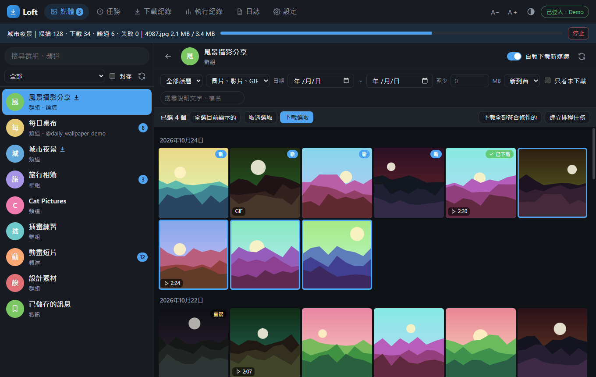
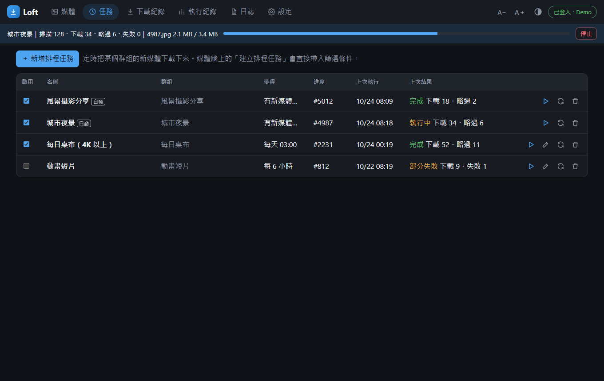

# Loft

**English** ｜ [繁體中文](README.zh-TW.md)

A desktop app for downloading media from Telegram with your own account. Open a group or channel and you get a media wall — every topic of a forum group in one place. Select what you want, or set up tasks that download new media automatically. Duplicates are skipped for you. Please respect the creators' copyright.

> ⚠️ Logs in to Telegram as you through the official API. Downloading too aggressively can get your account rate-limited. The login session is stored in Loft's data folder: never share it. Use at your own risk.

The interface is in Traditional Chinese.



## Features

- Media wall for groups, channels and forum topics; filter by type, date, size, caption
- Download selected, everything matching, or new media automatically
- Built-in duplicate detection (same file, same content, or looks the same); hide what you don't want
- Scheduled tasks, tray notifications, fast parallel downloads with an optional speed limit



## Download

Get the version for your system from [Releases](../../releases), unzip it (on Mac, open the dmg) and run it — no installation needed.

If you get a security warning the first time: on Windows click "More info" → "Run anyway"; on Mac right-click Loft → "Open".

## Getting started

1. Create an app at [my.telegram.org/apps](https://my.telegram.org/apps) to get an `api_id` and `api_hash`.
2. Open Loft → Settings (設定), enter them, then log in with your phone number.
3. Go to Media (媒體) and pick a group.

Closing the window keeps Loft running in the tray; quit from the tray menu. To remove Loft, turn off "start at login" if you turned it on, then delete its folder — nothing else is left on your computer.

## Keyboard shortcuts

| Key | Action |
|---|---|
| Click the ✓ / `Ctrl` + click | Select |
| `Shift` + click | Select a range |
| `Ctrl` + `A` | Select everything shown |
| `Esc` | Clear the selection |
| Right-click | Download, hide (including look-alikes), … |
| `←` `→` or wheel | Flip through media in the viewer |
| Space | Slideshow in the viewer |
| `Z` | Zoom in the viewer |
| `D` | Download the current item in the viewer |

## Running from source

Requires Node.js 22.13 or newer.

```
npm install
npm run app      # desktop app
npm start        # or open http://127.0.0.1:8787 in your browser
npm run dist     # package
```

## License

[MIT](LICENSE)
