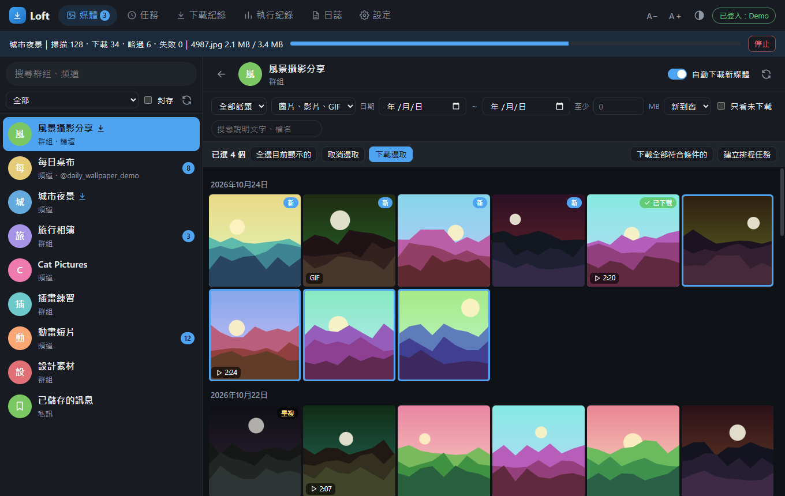
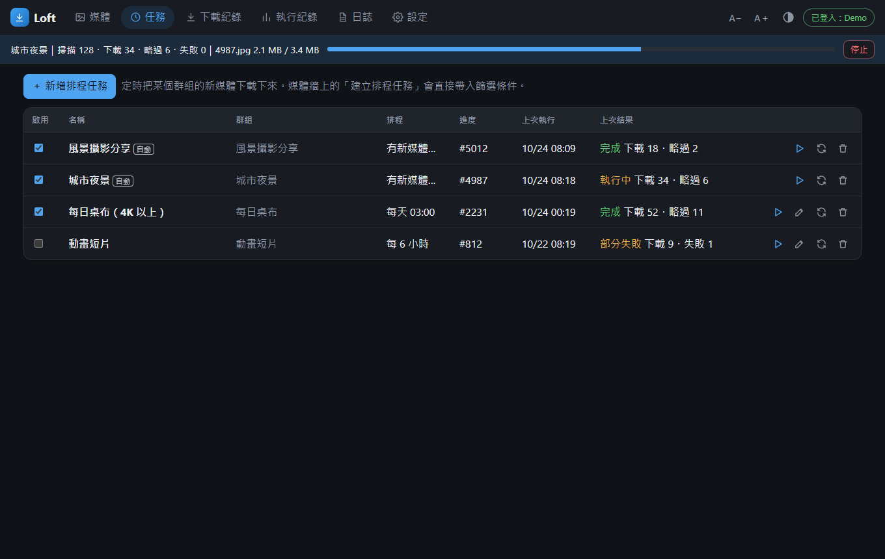

# Loft

[English](README.md) ｜ **繁體中文**

用你自己的 Telegram 帳號下載媒體的桌面 App。點開群組或頻道就是媒體牆，論壇群組的所有話題合在一起看。勾選想要的，或設定任務自動下載新媒體；重複的會自動略過。請尊重創作者的著作權。

> ⚠️ 透過 Telegram 官方 API 以你的身分登入。下載得太兇可能會被暫時限流。登入資料存在 Loft 的資料夾裡，千萬不要分享出去。使用風險自負。



## 功能

- 群組、頻道、論壇話題的媒體牆；可依類型、日期、大小、說明文字篩選
- 下載勾選的、全部符合條件的，或有新媒體就自動下載
- 內建重複判定（同一個檔案、內容相同、看起來一樣）；不想看的可以隱藏
- 排程任務、系統列通知、大檔分段並行下載，可設速度上限



## 下載

到 [Releases](../../releases) 下載你系統的版本，解壓縮（Mac 打開 dmg）後直接執行，不用安裝。

第一次開啟若出現安全性警告：Windows 按「其他資訊」→「仍要執行」；Mac 對 Loft 按右鍵 →「打開」。

## 開始使用

1. 到 [my.telegram.org/apps](https://my.telegram.org/apps) 建立應用程式，拿到 `api_id` 和 `api_hash`。
2. 開啟 Loft →「設定」填入，再用手機號碼登入。
3. 到「媒體」點一個群組就開始了。

關掉視窗後 Loft 會留在系統列繼續跑，要結束請從系統列選單按「結束」。要移除 Loft：如果開過「開機自動執行」先取消勾選，再刪掉它的資料夾就好，不會在電腦其他地方留下東西。

## 快捷鍵

| 按鍵 | 功能 |
|---|---|
| 點 ✓ / `Ctrl` + 點 | 選取 |
| `Shift` + 點 | 連續選取 |
| `Ctrl` + `A` | 全選目前顯示的 |
| `Esc` | 取消選取 |
| 右鍵 | 下載、隱藏（含相似的）等 |
| `←` `→` 或滾輪 | 預覽時切換上一個／下一個 |
| 空白鍵 | 預覽時自動播放 |
| `Z` | 預覽時放大 |
| `D` | 下載正在預覽的這個 |

## 從原始碼執行

需要 Node.js 22.13 以上。

```
npm install
npm run app      # 桌面版
npm start        # 或用瀏覽器開 http://127.0.0.1:8787
npm run dist     # 打包
```

## 授權

[MIT](LICENSE)
